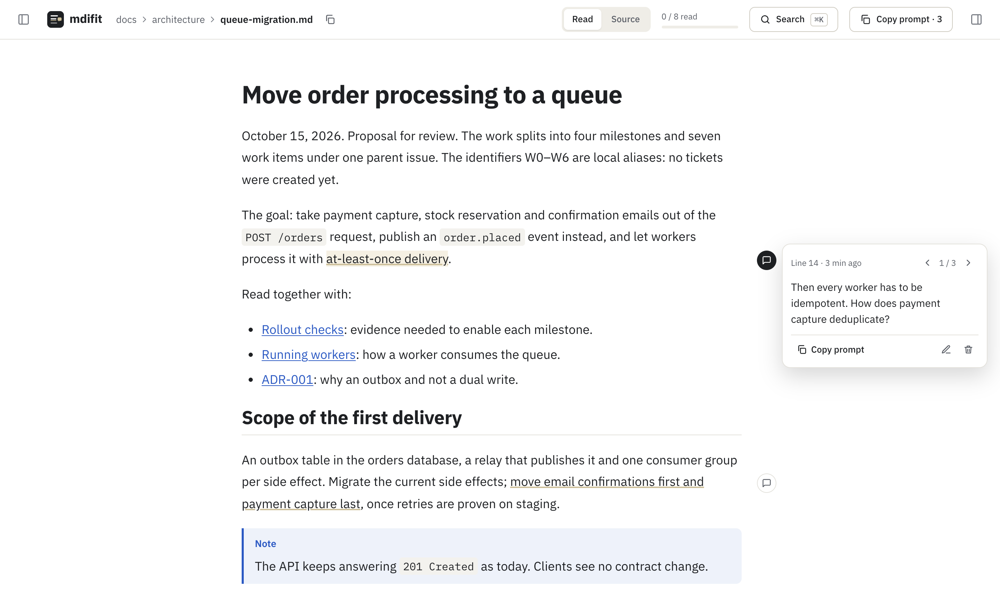

<h1 align="center">
  <picture>
    <source media="(prefers-color-scheme: dark)" srcset="docs/images/logo-dark.png">
    
  </picture>
</h1>

<p align="center">
  Read a folder of Markdown in your browser, comment while you read,<br>
  and copy the whole review as a prompt for your coding agent.
</p>

<p align="center">
  <a href="https://github.com/pechitook/mdifit/actions/workflows/ci.yml"></a>
  <a href="LICENSE"></a>
</p>

```bash
npx mdifit docs/
```

<picture>
  <source media="(prefers-color-scheme: dark)" srcset="docs/images/screenshot-dark.png">
  
</picture>

<p align="center">
  <a href="https://pechitook.github.io/mdifit/demo.mp4"><strong>Watch the 36-second demo</strong></a>
  · <a href="https://pechitook.github.io/mdifit/">Website</a>
</p>

Agents write more and more of their work to disk as Markdown: plans, specs, reports,
notes. mdifit is the reviewing side of that loop. It renders the folder like a good
Markdown reader, lets you comment on any line, range or phrase as you read, and turns your
comments into text an agent can act on:

```
docs/architecture/queue-migration.md:L25-L26
> move email confirmations first and payment capture last
Add a rollback criterion if the email worker lags more than 5 minutes.
=====
docs/architecture/rollout-checks.md:L12
What counts as "processed"? The ack, or the row in processed_events?
```

The format is the same as [difit](https://github.com/yoshiko-pg/difit)'s, so it pastes the
same way into Claude Code, Codex, opencode or any chat.

## Features

- **Browse folders**: a folder opens with its `README.md` or `AGENTS.md`, with its file
  list one click away; a breadcrumb takes you back up.
- **Reads like a Markdown reader**: GitHub-flavored Markdown, tables, task lists,
  `> [!NOTE]` alerts, syntax highlighting, Mermaid diagrams, relative links and images,
  light and dark.
- **Comment while you read**: select any text and press <kbd>C</kbd>, or click a block's
  line number. The comment points at the exact source lines of the selection.
- **Suggest edits**: select text and press <kbd>S</kbd> to propose a replacement; it goes
  into the prompt as `ORIGINAL` / `SUGGESTED`.
- **Source view**: switch to the raw Markdown (<kbd>V</kbd>) to comment on formatting,
  links or front matter; shift-click line numbers for a range.
- **Copy all prompt**: review the generated prompt, edit it if you like, copy it
  (<kbd>P</kbd>, then <kbd>⌘</kbd><kbd>↵</kbd>). Per-comment copy too.
- **Search everything**: <kbd>⌘</kbd><kbd>K</kbd> finds files, headings and text across
  the folder, accents ignored.
- **Reading progress**: mark files read (<kbd>R</kbd>); a file changed after you read it
  shows as *edited* and counts as unread again.
- **Live reload**: when an agent edits a file, the page updates.
- **Focus**: hide the files panel (<kbd>B</kbd>) or the comments panel (<kbd>N</kbd>);
  the layout is remembered.

Press <kbd>?</kbd> in the app for every shortcut.

## Usage

```bash
npx mdifit                 # the current folder
npx mdifit docs/           # a folder
npx mdifit PLAN.md         # a single file
npx mdifit docs --no-open  # do not open the browser
```

mdifit serves on `http://localhost:1905`, or the next free port when another folder is
already open there. Your comments are stored in your browser per port and per folder, so
each folder remembers its port and gets it back next time. Running mdifit again on the same
folder reuses the open instance. `--port 5000` serves on exactly that port; a port the
folder has not used before starts with an empty review.

Nothing is written to the folder. The server only reads Markdown and images inside it, only
on `127.0.0.1`, and only for requests addressed to `localhost`. Raw HTML in Markdown is
shown as text, never executed.

Requires Node.js 24 or later.

## Development

```bash
npm install
npm run dev                 # hot-reloading UI + API over fixtures/docs on :47614
npm run dev -- ~/your/docs  # or over any folder
npm run check               # lint, format, typecheck, tests
npm run build
```

The landing page lives in `site/` (static, deployed to GitHub Pages by `.github/workflows/pages.yml`).

How it is built: [ARCHITECTURE.md](ARCHITECTURE.md). Conventions: [AGENTS.md](AGENTS.md).
Contributing: [CONTRIBUTING.md](CONTRIBUTING.md).

## License

[MIT](LICENSE)
