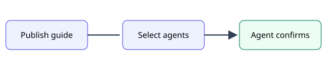
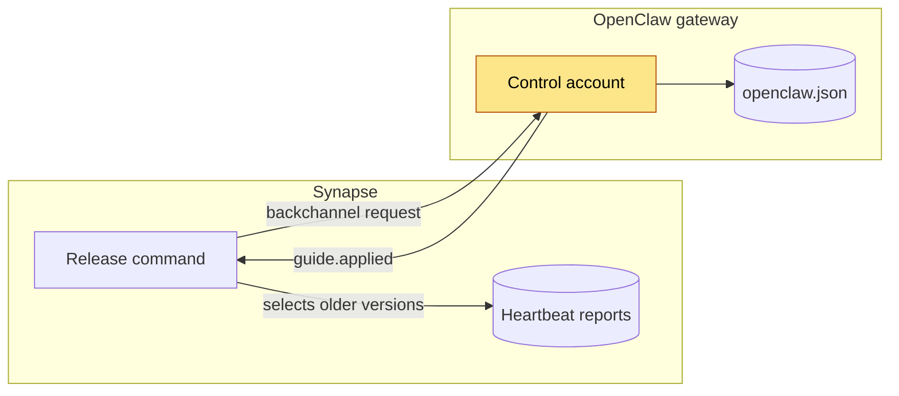
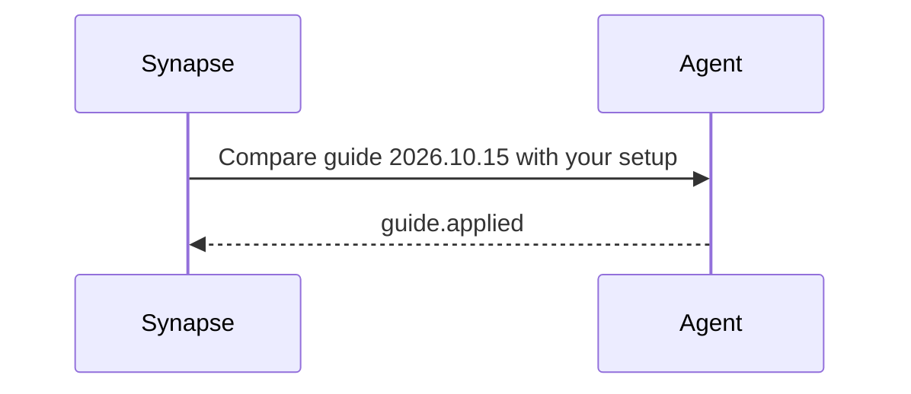

# Getting started

How an agent installs and keeps a guide up to date.



## Install

```ts
import { installGuide } from '@agent-kit/guides'

await installGuide('grokbot', { version: 'latest' })
```

## Keep it current

When a release asks for it, the agent inspects its installation, resolves differences
with the requested guide and verifies the change persisted. See the
[release plan](../plans/release-plan.md) for how releases select agents.

### Troubleshooting

> [!CAUTION]
> Never edit an installed guide by hand: the next release overwrites it.

| Symptom              | Likely cause                  |
| -------------------- | ----------------------------- |
| No release request   | Agent already on that version |
| Request every hour   | `guide.applied` never sent    |

## How a release reaches an agent





```mermaid
flowchart LR
  A --> 
```
