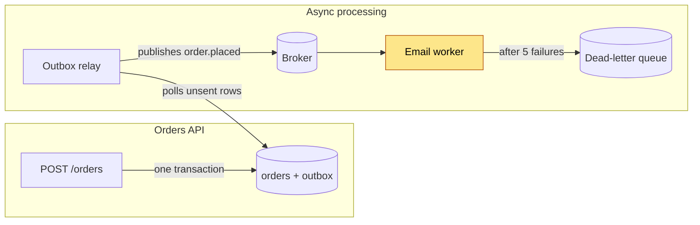
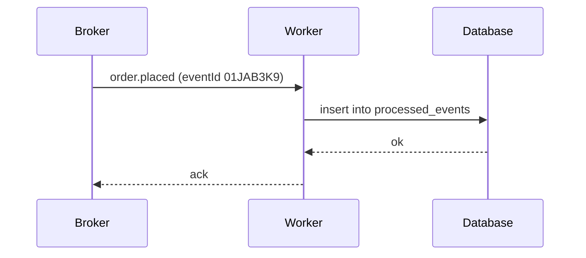

# Running workers

How a worker consumes the order queue and keeps processing safe to repeat.


## Start a worker

```ts
import { createConsumer } from './queue/consumer.ts'

const consumer = createConsumer({ group: 'email', topic: 'order.placed', concurrency: 8 })
await consumer.run(async (event) => sendConfirmation(event.orderId))
```

## Make it idempotent

The broker may deliver a message more than once. Before running a side effect, the worker
records the `eventId` in `processed_events`; if the insert conflicts, the message is a
duplicate and is acknowledged without doing anything. See the
[queue migration](../architecture/queue-migration.md) for the delivery guarantees.

### Troubleshooting

> [!CAUTION]
> Never delete rows from the outbox by hand: the relay may not have published them yet.

| Symptom                   | Likely cause                         |
| ------------------------- | ------------------------------------ |
| Duplicate emails          | `eventId` not recorded before acking |
| Consumer lag keeps rising | A poison message is being retried    |

## How an order reaches a worker





```mermaid
flowchart LR
  A --> 
```
